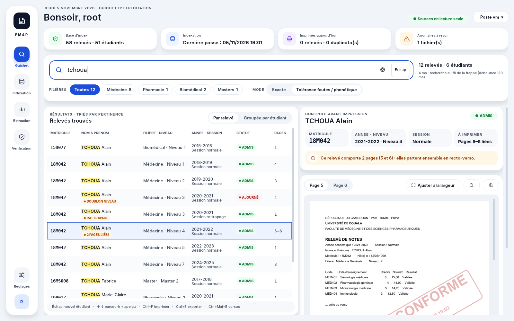

# Scolarix — Archives des relevés de notes (FMSP)


Application de bureau Windows pour la Cellule Informatique de la FMSP (Université de Douala).
Elle **indexe les relevés de notes** accumulés au fil des années (Word .doc/.docx, PDF texte, PDF scannés),
puis permet au guichet de **retrouver, prévisualiser, imprimer et exporter un relevé en moins de 10 secondes**,
sans ouvrir Word ni Adobe et **sans jamais modifier les originaux**.

Python 3.11+ · PySide6 (Qt 6, QtPdf) · SQLite WAL + FTS5 · pypdfium2 · python-docx · Tesseract · pypdf · reportlab



## Ce que fait l'application

| Écran | Fonctions | Cas des documents couverts |
|---|---|---|
| **Guichet** | Omnibox avec recherche au fil de la frappe (délai de 120 ms après la dernière touche) et normalisation `19-m/042 → 19M042`. Tolérance aux fautes, filtres par filière. Tableau avec surlignage de la frappe et pastilles (ADMIS, AJOURNÉ, RATTRAPAGE, 2 PAGES LIÉES, PROCHE À 92 %, DOUBLON NIVEAU, SCAN OCR). Aperçu PDF haute définition dans un split-view 55/45. Bandeaux d'alerte (échec/rattrapage, pages liées, OCR, résultat approché). Impression directe, export PDF unitaire, timbre « Duplicata conforme », vue groupée par étudiant. | S1.1–S1.4, S2.1, S2.4, S3.3, S4.2 |
| **Cursus** | Fusion chronologique N1 → N7 en un seul PDF avec page de garde. Les échecs sont exclus quand un rattrapage ADMIS existe. Les niveaux manquants sont signalés. Un ancien matricule peut être rattaché (même nom + date de naissance). | S1.4, S2.1, S2.2 |
| **Indexation** | Robot dans un processus séparé qui ne gèle jamais l'interface, avec **plusieurs processus de lecture en parallèle**. Le guichet reste utilisable pendant qu'il travaille. Les `.docx` sont lus directement (pas de conversion), les `.doc` passent par Word/LibreOffice en `.docx`, les scans par l'OCR (redressement + Otsu). **Exclusion de sous-dossiers et de motifs** (`*DIPLOME*`…). Arrêt propre, mode différentiel, vérification d'intégrité, journal d'anomalies, statistiques du fonds. | S4.1, S4.3, S4.4 |
| **Corrections Word** | Sur les seuls fichiers Word, corrections de texte appliquées à une **copie** au moment de l'aperçu, de l'impression et de l'export : retrait de l'ancien téléphone, « Ref N° » devant le titre, nouvelle référence `/FMSP/VDPSAA/VDSSE/VDRC/CDAASSR/SSE`. Règles modifiables (Réglages › Corrections), essai en direct, mention dans le journal. | — |
| **Extraction & journal** | Listes pour le Décanat (filière, plage d'années, statut, dernier niveau) exportées en Excel ou CSV. Journal non modifiable des consultations, impressions, exports, duplicatas et vérifications. | S3.2, traçabilité |
| **Vérification** | Document soumis et original affichés côte à côte, comparaison champ par champ (notes, moyenne, décision), rapport PDF et journalisation. | S3.1 |

Raccourcis :

| Raccourci | Action |
|---|---|
| `Échap` / `Ctrl+F` | Nouvelle recherche |
| `↑` `↓` | Parcourir les résultats avec mise à jour de l'aperçu |
| `Ctrl+P` | Imprimer le relevé affiché |
| `Ctrl+E` | Exporter le relevé affiché |
| `Ctrl+Maj+E` | Cursus complet |
| `Ctrl+1…4` | Changer d'écran |

## Installation

**Le plus simple : l'installateur** `Scolarix_Setup_x.y.z.exe` (artefact « Scolarix_Installateur_Windows » des
GitHub Actions, ou page *Releases*). Il installe Scolarix dans *Program Files*, crée les raccourcis (menu
Démarrer, bureau en option) et un désinstallateur (Paramètres › Applications). Les données (index, cache,
configuration) restent dans `%APPDATA%\FMSP_Archives` et ne sont pas effacées à la désinstallation.
Une version portable (zip) est aussi produite.

### Poste de développement (Windows 10/11)

1. **Python 3.11 ou plus récent** — https://www.python.org (cocher « Add to PATH »).
2. **Tesseract OCR** avec la langue française — https://github.com/UB-Mannheim/tesseract/wiki
   (installer dans `C:\Program Files\Tesseract-OCR`, cocher *French* dans les langues).
3. **Pour les vieux `.doc` 97-2003** : Microsoft Word installé sur le poste, **ou** LibreOffice (gratuit).
4. *(Facultatif, recommandé)* **SumatraPDF** portable : déposer `SumatraPDF.exe` dans le dossier `tools\`
   pour une impression vectorielle silencieuse. Sans lui, l'impression passe par Qt sur l'imprimante par défaut.
5. Dans le dossier du projet :

```bat
run_dev.bat
```

(crée l'environnement virtuel, installe les dépendances et lance l'application).

### Construire l'exécutable autonome

```bat
build_windows.bat
```

Le script lance les tests, produit `dist\Scolarix\Scolarix.exe`, puis l'installateur `Output\Scolarix_Setup_x.y.z.exe` si [Inno Setup 6](https://jrsoftware.org/isinfo.php) est installé. Tesseract est nécessaire **uniquement sur le poste qui indexe** ; Word ou LibreOffice sur le poste qui indexe des `.doc` **et** sur les postes qui affichent ou impriment des relevés Word (l'aperçu PDF est produit à la première consultation, puis gardé en cache).

## Dossier des exports

Réglages › Exports. Par défaut `Documents\Exports Scolarix` du poste ; un dossier partagé du service
(`\\serveur\Scolarité\Exports`, accès réservé au personnel habilité) réunit les exports de tous les guichets.

```
Exports Scolarix\
├─ Releves\AAAA\MM\       FMSP_<matricule>_<NOM>_<année>_Niv<n>_S<s>_<AAAAMMJJ-HHMM>.pdf
├─ Duplicatas\AAAA\MM\    …_DUPLICATA_<horodatage>.pdf                 (conservés)
├─ Cursus\AAAA\MM\        FMSP_<matricule>_<NOM>_Cursus_<horodatage>.pdf
├─ Extractions\AAAA\MM\   Decanat_<filtres>_<horodatage>.xlsx           (conservées)
├─ Verifications\AAAA\MM\ Verification_<matricule>_<horodatage>.pdf
└─ Journal\                 Journal_<horodatage>.csv                      (conservés)
```

- Classement par nature de demande puis par mois ; aucun fichier n'est jamais écrasé.
- Chaque document délivré (impression, export, duplicata, cursus) reçoit un **numéro de délivrance**
  `00042/<poste>/2026`, inscrit au journal avec l'emplacement et l'empreinte SHA-256 du fichier ;
  l'écran Vérification reconnaît ensuite un fichier sorti du guichet. Option : imprimer ce numéro en bas de page.
- Conservation : relevés, cursus et vérifications (recopiables depuis les archives) supprimés après
  30 jours (réglable) ; duplicatas, extractions et journaux conservés.
- Après chaque export, un bouton « Ouvrir le dossier » montre le fichier dans l'explorateur.

## Vitesse d'indexation

Mesures sur les relevés réels fournis (14 fichiers, 127 relevés) et sur un lot de 560 fichiers :

| Étape | Avant | Maintenant |
|---|---|---|
| Texte d'un PDF collectif de 87 pages | ≈ 24 s (pdfplumber) | ≈ 0,3 s (pypdfium2, même texte) |
| Relevé `.docx` | conversion Word → PDF (plusieurs secondes) | lecture directe ≈ 0,05 s ; aperçu produit à la 1re consultation |
| Relevé `.doc` 97-2003 | Word → PDF | Word → `.docx` (plus rapide), puis lecture directe |
| 560 fichiers, 1 processus | — | 31 s (18 fichiers/s) |
| 560 fichiers, 2 processus (2 cœurs) | — | 16 s (35 fichiers/s) |
| Relance différentielle (rien de changé) | — | 0,01 s |

Les gains réels dépendent du partage réseau et de la part de scans (OCR) et de `.doc`. Réglages › Indexation :
nombre de processus (automatique = cœurs − 1, au plus 4) et exclusions.

## Tester tout de suite, sans les vraies archives

```bat
python tools\generate_samples.py archives_demo
python main.py
```

Puis, dans l'application : **Indexation** → choisir `archives_demo` → ▶. Revenez ensuite au **Guichet** et essayez les recherches suivantes :

| Recherche | Ce qu'elle démontre |
|---|---|
| `tchoua` | Homonymes, plus `TCHOUWA` en résultat approché |
| `18-m/042` | Matricule normalisé ; cursus avec N3 en échec + rattrapage, N4 sur 2 pages, N6 manquant, corrélation avec `15B077` |
| `kouam` | Tolérance aux fautes |
| `ndoukou` | Apostrophes ignorées |
| `marie claire` | PDF scanné lu par OCR |

Le fichier `.doc` corrompu du jeu d'essai apparaît dans le journal d'anomalies, sans arrêter l'indexation.

En ligne de commande :

```bat
python main.py --index --source "\\SRV-FMSP\Archives_Releves" --only-new
python main.py --check-integrity
python -m pytest
```

## ⚠️ À faire sur les vraies archives : ajuster le parsing

Le format des relevés a changé au fil des années. Toutes les règles de lecture sont regroupées dans
**`core/parsing.py` → `PATTERNS`** : libellés « Matricule », « Noms et Prénoms », « Niveau », « Décision du jury », etc.

Méthode conseillée :

1. Indexer **un échantillon** (2–3 fichiers par année et par format).
2. Consulter le journal d'anomalies : « nom non détecté », « année non détectée », « aucun relevé détecté ».
3. Adapter les expressions de `PATTERNS` et ajouter un test dans `tests/test_core.py` avec un extrait réel.
4. Lancer une réindexation complète.

L'arborescence aide aussi : année (`2020-2021`), filière (`Medecine`, `Pharmacie`…), session (`SN`/`SR`)
et niveau (`N3`) sont lus dans le chemin quand le document ne les mentionne pas (voir `hints_from_path`).

## Architecture

```
fmsp_archive_app/
├── main.py                    # interface, ou robot d'indexation avec --index
├── core/                      # métier, sans dépendance à l'interface
│   ├── config.py              # réglages (%APPDATA%\FMSP_Archives\config.json)
│   ├── normalize.py           # matricules 18M042 / 18-M-042 / 18/M/042, noms sans accents
│   ├── database.py            # SQLite WAL, FTS5 trigram, recherche floue rapidfuzz, journal
│   ├── extractors.py          # PDF, OCR (deskew + Otsu), Word → PDF (COM / LibreOffice), .docx
│   ├── parsing.py             # blocs étudiant, relevés sur plusieurs pages, métadonnées
│   ├── indexer.py             # robot : processus parallèles, exclusions, différentiel, arrêt propre
│   ├── preview.py             # aperçu PDF des relevés Word produit à la demande (+ pages recalculées)
│   ├── text_rules.py          # corrections de texte des .docx (copie, en-têtes, runs découpés)
│   ├── pdf_tools.py           # découpe, fusion du cursus, timbre Duplicata
│   ├── printer_service.py     # impression silencieuse (SumatraPDF / PDFtoPrinter / Qt)
│   ├── exporter.py            # Excel / CSV
│   └── verification.py        # comparaison document soumis / original, rapport PDF
├── ui/                        # PySide6
│   ├── theme_fmsp.qss         # Design System v3.1
│   ├── main_window.py         # rail de navigation, raccourcis globaux
│   ├── guichet_page.py        # Zones A/B/C (Omnibox, tableau, aperçu)
│   ├── omnibox_widget.py · results_table_model.py · pdf_preview_panel.py
│   ├── cursus_dialog.py · indexing_page.py · extraction_page.py · verification_page.py
│   └── widgets.py · icons.py · settings_dialog.py
├── tools/generate_samples.py  # faux fonds d'archives pour tester
├── tools/screenshots.py       # captures automatiques
├── assets/                    # logo (SVG, ICO, PNG) et images de l'installateur
├── installer/scolarix.iss     # installateur Inno Setup
└── tests/                     # 82 tests : parsing (formats réels anonymisés), indexation parallèle,
                               # exclusions, corrections Word, aperçu à la demande, recherche, exports, interface
```

**Règles métier respectées**

- **Non-destruction.** Le dossier des archives est seulement lu. Les conversions Word passent par une copie temporaire ou par Word en lecture seule, et les PDF générés vont dans le cache ou sur le Bureau.
- **Données locales.** La base et le cache sont dans `%APPDATA%\FMSP_Archives` (modifiable dans Réglages). Rien n'est envoyé sur un cloud.
- **Traçabilité.** Chaque consultation, impression, export, duplicata, cursus, extraction et vérification est inscrit dans la table `journal`.

**Écarts corrigés par rapport au plan directeur**

- **Schéma SQL.** `VARCHAR INDEXED` n'existe pas en SQLite : les index sont créés séparément. La table FTS5 est synchronisée par des triggers.
- **Numéros de page Word.** Un document Word n'a pas de pages fixes. À l'indexation, la pagination est estimée (sauts de page enregistrés par Word, en-têtes de relevé) ; à la première consultation, le PDF rendu par Word donne les **vrais** numéros de page, et chaque relevé du fichier y est retrouvé par son matricule avant tout affichage ou impression.
- **Levenshtein.** SQLite ne le propose pas : la recherche combine FTS5/`LIKE` et `rapidfuzz`.

## Limites connues / suite possible

- Testé ici sous Linux sur le jeu d'essai, avec LibreOffice et Tesseract. **Ce qui doit être validé sur un poste Windows réel :**
  - la passerelle COM Word ;
  - l'impression (spouleur Windows) ;
  - l'exécutable PyInstaller.
- La vérification d'authenticité compare le **texte**. Une falsification de la mise en page seule se voit sur l'aperçu côte à côte, pas dans le tableau.
- Phase 2 prévue par le plan : version web interne (FastAPI + React) réutilisant `core/` tel quel.
